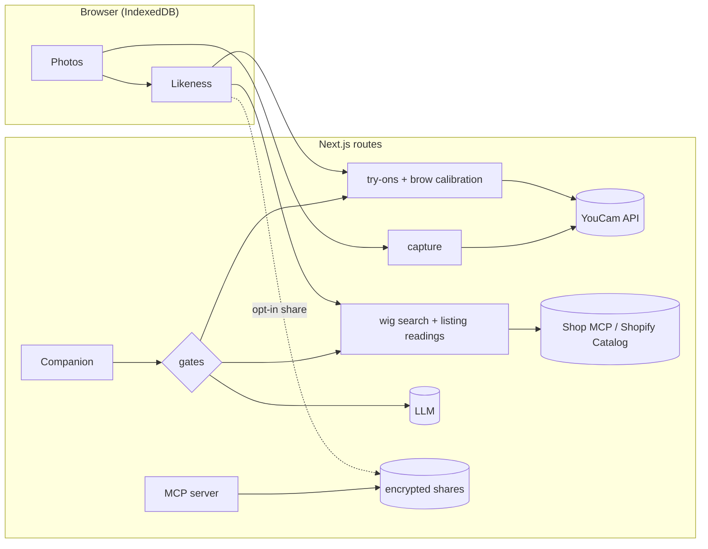

# Kept

**Keep looking like you through chemotherapy.**

Before treatment changes your hair and brows, Kept measures them with YouCam's AI — hair curl, density and length, brow colour and shape, skin tone — and reads your exact hair shade from the same photo. Every wig, brow and colour you choose afterwards starts from that measured likeness, not from guesswork.

- **Live app:** https://kept-likeness.vercel.app (demo personas work without a camera or an account)
- **Proof:** https://kept-likeness.vercel.app/proof · [CLAIMS.md](CLAIMS.md) · [JUDGES.md](JUDGES.md)

## Why

Chemotherapy-induced hair loss affects about 65% of people who receive chemotherapy, and in a survey of 1,478 patients it ranked as the most traumatic side effect (82.6% severe or moderate). Hair starts to go a mean of **18 days** after the first infusion; brows (90%) and lashes (88%) follow later. Cancer charities tell people to choose a wig *before* the hair goes and to save a lock of hair to match the colour — but every wig try-on starts after. Kept starts before.

Sources: [Watanabe et al. 2019](https://pmc.ncbi.nlm.nih.gov/articles/PMC6326423/) · [American Cancer Society](https://www.cancer.org/cancer/side-effects/hair-skin-nails/hair-loss/choosing-and-wearing-wig.html) · [NIH InformedHealth](https://www.ncbi.nlm.nih.gov/books/NBK547552/)

## What it does

| | |
|---|---|
| **Likeness** | Four photos (front, two three-quarter turns, the parting). YouCam measures curl pattern, density, length, brow colour, brow shape and thickness, skin tone, Fitzpatrick type and face shape. Every value shows the API and date that produced it. |
| **Hair** | Real wigs from Shopify stores via Shop MCP. Kept reads the hair shade on every listing photo the same way it read yours and ranks them by colour distance (CIEDE2000), texture and length. Try any of them on your own *before* photo with YouCam's hairstyle transfer. Checkout is prepared at the store; you review and pay there. |
| **Brows** | When brows thin, YouCam's makeup try-on draws them back on today's photo in your measured shape. YouCam's Face Analyzer then measures the drawing, and Kept corrects the colour until it reads as the shade measured before treatment. The try-on's skin retouch is undone so the brows sit on your own skin tone. |
| **Companion** | An assistant for appearance questions that can search, rank, render and prepare checkouts. Medical questions never reach it: a keyword router and a separate classifier send them to a care-team card first, and every reply is linted for medical claims. |
| **Wig specialists** | A consented, expiring share link (measurements only unless the person adds a photo) and a specialist view. The same link works over Kept's MCP server. |
| **Privacy** | Photos and measurements stay in the browser. YouCam tasks are deleted right after their results are read. One tap deletes everything and withdraws every share. |

## How it works



Packages:

| Package | Role |
|---|---|
| `packages/likeness` | Pure domain core: likeness schema with provenance, CIEDE2000 colour maths, wig ranking, hair-shade sampling helpers, brow pattern mapping, closed-loop colour correction, treatment timeline, cited product rules, claim linter, scope router. |
| `packages/youcam` | Typed YouCam client: file upload, async tasks with polling, unit ledger with session and global caps, engine-error → plain-language retake mapping, record/replay transport for tests. |
| `packages/shop` | Shop MCP client (stateless MCP 2026-07-28): catalog search, listing mapping, UCP checkout preparation. |
| `packages/agent` | The Companion: tools, gates (scope router + fail-closed classifier, claim linter, product rules, spend allowlist, strict tool inputs, unit budget) and a receipt log. |
| `packages/mcp` | Kept's MCP server: `likeness_summary`, `match_wigs`, `check_product`, `typical_timeline`, scoped by share token. |
| `apps/web` | Next.js 16 app: landing, the mobile-first app, specialist view, proof page, API routes. |
| `eval/` | Guardrail evaluation with pre-registered cases, a blind held-out set and a negative control. |
| `scripts/audit` | Wig colour-name audit. `scripts/record` records the demo personas from live API calls. |

### YouCam APIs used

Skin Tone Analysis · Face Attributes & Ratio Analyzer · Hair Type Detection · Hair Length Detection · Hair Density Detection · Fitzpatrick Skin Type (and its pre-process face detection) · Makeup VTO (eyebrows, eyelashes) · Hairstyle Transfer · Hat VTO · task deletion · unit balance.

## Run it

```bash
pnpm install
cp .env.example apps/web/.env.local   # fill in the keys you have
pnpm test                             # 170+ unit and integration tests
pnpm dev                              # http://localhost:3000
```

| Variable | Needed for |
|---|---|
| `YOUCAM_API_KEY` | live measuring, try-ons and listing readings |
| `KEPT_UNIT_CAP`, `KEPT_SESSION_UNIT_CAP`, `KEPT_UNIT_FLOOR` | spending limits for live mode |
| `LLM_BASE_URL`, `LLM_API_KEY`, `LLM_MODEL`, `LLM_CLASSIFIER_MODEL` | the Companion and its scope classifier (any OpenAI-compatible endpoint) |
| `SHARE_ENCRYPTION_KEY` | 32-byte base64 key for share links at rest |
| `BLOB_READ_WRITE_TOKEN` | share storage on Vercel Blob (memory fallback locally) |

Without keys the demo personas still work end to end from recorded results.

```bash
pnpm eval                                        # guardrail eval against a live model
pnpm --filter @kept/audit audit                  # wig colour-name audit
pnpm --filter @kept/record record capture anna   # re-record a demo persona
```

## Honest limits

- **Demo personas are synthetic.** Anna and Marcus were generated for the demo; their measurements are real, recorded YouCam results replayed in the app.
- **Hair colour is read by Kept, not by YouCam.** YouCam's hair-colour attribute returns one of six families and read both personas' hair (chestnut and black) as "Auburn", so Kept samples the shade itself from the band of hair above the face YouCam finds. Listing photos are read the same way; collages and side views are marked "not measured" rather than guessed.
- **Brow colour is reported in steps.** YouCam returns brow colour from a set of shades, so "same shade" means the drawing reads as the step measured before treatment. The calibration reached the same shade for Anna in three rounds; for Marcus (deep skin) the best was ΔE 11.4, and a third round made it worse — the loop keeps the best round.
- **Try-ons are previews.** Hairstyle transfer can carry accessories from the model photo; the hat try-on generates a styled outfit and setting. The makeup try-on still smooths fine skin texture after Kept restores the skin tone.
- **Typical timelines are averages** from one large study; Kept says so wherever it shows dates.
- **Spending limits are per server instance.** Live YouCam calls are capped per session, per IP and per deployment, and requests are rate-limited, but those counters live in each serverless instance's memory; the hard stop is a floor on the account's real unit balance.
- **Not medical.** Kept doesn't diagnose, treat or advise on treatment, and is tested for that (see `/proof`).

## License

MIT
